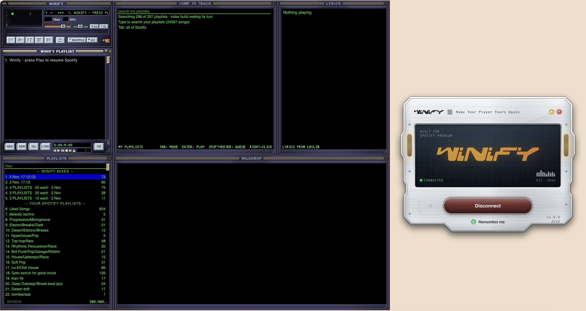
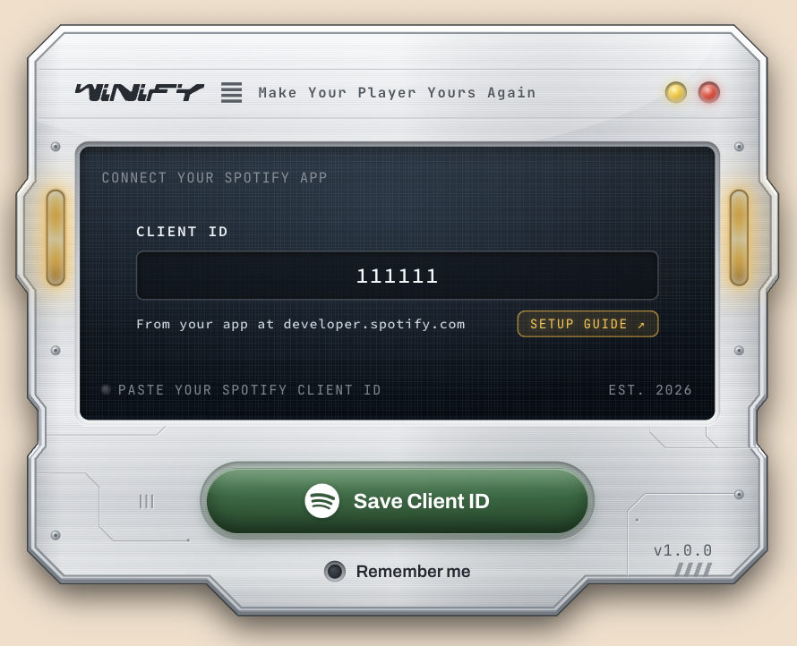
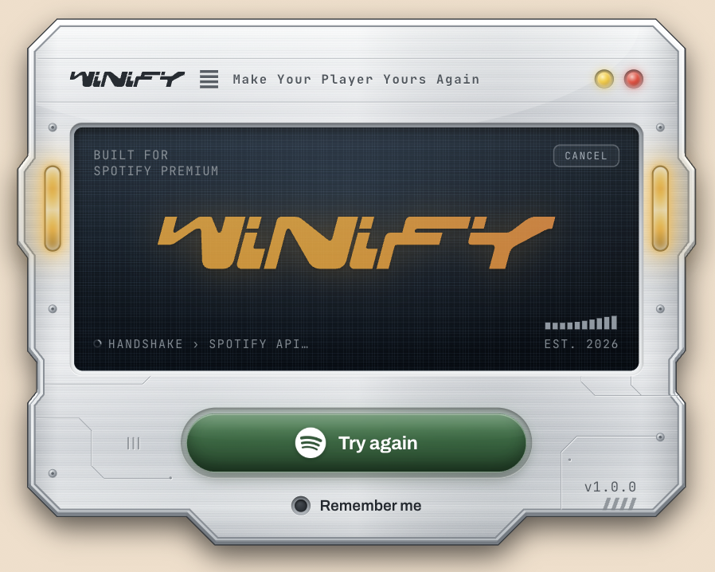
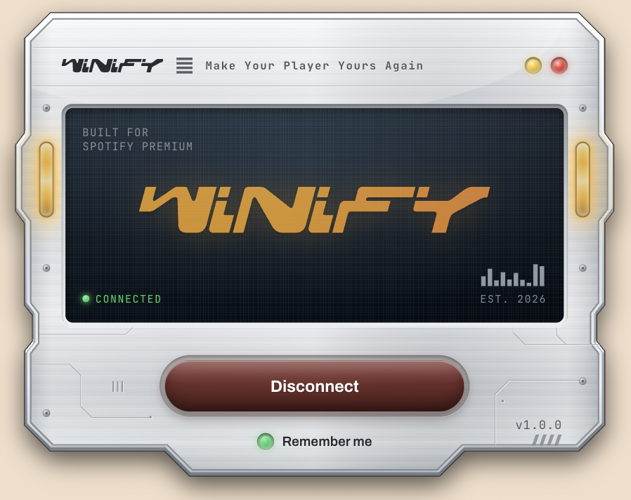
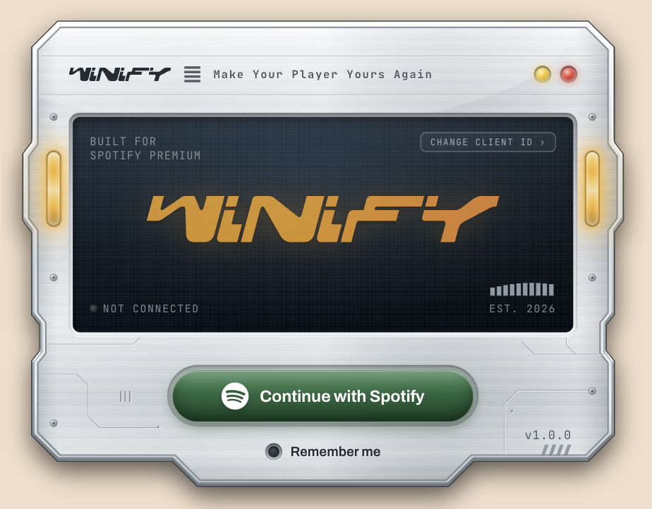
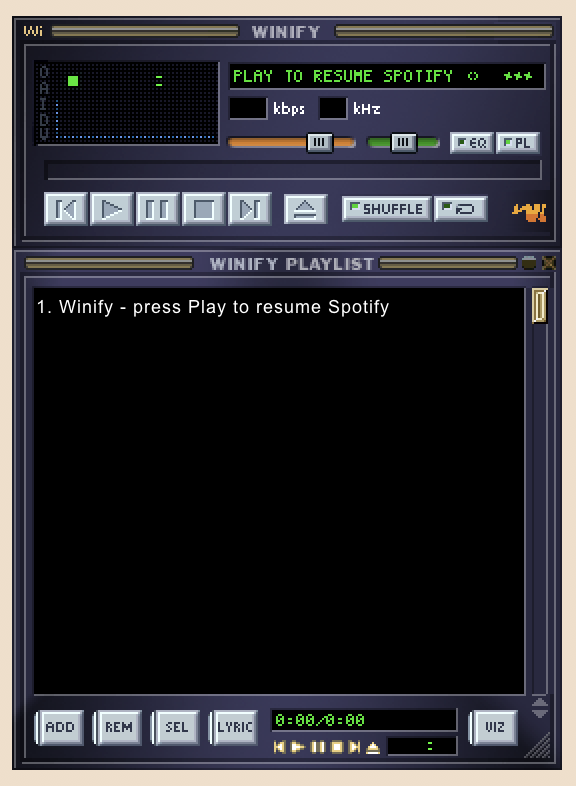
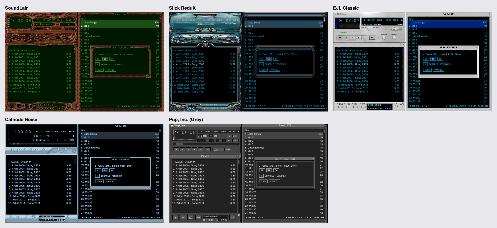

# Winify

Spotify, played through a classic desktop music player on your Mac.

Winify plays your Spotify music in its own window, with classic buttons,
a playlist window and a visualizer. Spotify sees it as a device called **Winify**,
just like a speaker or your phone.



Winify is free and open source. There is no download: you build your own copy
from this page, with your own free Spotify and castLabs accounts. The steps below
walk you through it, and you don't need to know how to code.

## What you need

- A Mac
- A **Spotify Premium** account (Spotify does not allow this on free accounts)
- [Node.js](https://nodejs.org) (version 20 or newer)
- Python 3 (already on most Macs; used once during setup)

Setup takes about 15 minutes, once.

## Setup

### Step 1: Create your Spotify app

Spotify requires every Winify user to register their own (free) Spotify app.
You will get a **Client ID** from it, which Winify asks for later.

1. Open the [Spotify Developer Dashboard](https://developer.spotify.com/dashboard)
   and log in with your Spotify Premium account.
2. Click **Create app**. Any name and description will do, for example
   "My Winify".
3. Under **Redirect URIs**, paste this exactly, then click **Add**:

   ```
   http://127.0.0.1:8888/callback
   ```

4. Under **Which API/SDKs are you planning to use?**, tick **Web API** and
   **Web Playback SDK**.
5. Agree to the terms and click **Save**.
6. Open your new app's **Settings** and copy the **Client ID** (a mix of 32
   letters and numbers). You do not need the Client Secret.

> **Already have a Spotify developer app?** Spotify allows only one per
> person, so use it instead of creating a new one. In its **Settings**, add the
> redirect URI from step 3 next to the ones it already has, and make sure
> **Web API** and **Web Playback SDK** are ticked. Nothing else changes.

### Step 2: Install Winify

Open **Terminal** and run these, one at a time. They download Winify from
[GitHub](https://github.com/Parasthappa/Winify) into a folder called `winify`,
go into it, and install what it needs:

```bash
git clone https://github.com/Parasthappa/Winify.git winify
```

```bash
cd winify
```

```bash
npm install
```

(If your Mac asks to install the "command line developer tools" for `git`,
click **Install** and run the first line again. Or download the project from
GitHub with **Code > Download ZIP**, unzip it, and open Terminal in that
folder.) Run the other commands in this README from that same folder.

### Step 3: Allow Winify to play Spotify's audio

Spotify only sends audio to apps that carry a free signature from castLabs,
the company that makes the version of Electron Winify is built on. You sign
your copy once.

1. Install castLabs' signing tool:

   ```bash
   python3 -m pip install --upgrade castlabs-evs
   ```

2. Create your free castLabs account. You will be asked for an email address,
   a name and a password (it needs upper and lower case letters, a number and
   a symbol), then for a code sent to that email.

   ```bash
   python3 -m castlabs_evs.account signup
   ```

3. Sign your copy of Winify:

   ```bash
   python3 -m castlabs_evs.vmp sign-pkg node_modules/electron/dist
   ```

4. Check it worked. You should see **Signature is valid**:

   ```bash
   python3 -m castlabs_evs.vmp verify-pkg node_modules/electron/dist
   ```

> Run step 3 again whenever you run `npm install` again. If music ever starts
> skipping after a second or two, this is almost always why.

### Step 4: Start Winify

```bash
npm start
```

The first start takes a little longer than later ones.

### Step 5: Connect your Spotify app

1. Click **Get started**.
2. Paste the **Client ID** from step 1 and click **Save Client ID**. Winify
   checks it with Spotify, then signs you in.
3. Your browser opens Spotify's sign-in page. Log in and click **Agree**.
4. Winify shows **CONNECTED** and opens the player.

<table>
  <tr>
    <td></td>
    <td></td>
  </tr>
  <tr>
    <td></td>
    <td></td>
  </tr>
</table>

Next time you open Winify, click **Continue with Spotify**. Turn on
**Remember me** to stay signed in between launches.

To use a different Spotify app later, choose **Change Spotify Client ID...**
from Winify's menu-bar icon, or **CHANGE CLIENT ID** on the sign-in screen.

### Optional: make Winify a Mac app

Instead of starting Winify from Terminal each time, you can build it into an
app you open from Finder or the Dock. It needs steps 1 to 3 done first
(your castLabs account signs the app too).

```bash
npm run package
```

It takes a few minutes. You get **Winify.app** in the `dist/mac-arm64`
folder, and **Winify-1.0.0.dmg** in `dist`, a copy you can send to a friend.
Drag Winify.app into Applications to keep it.

The app keeps its own settings, apart from `npm start`: the first time you
open it, connect your Spotify app again (step 5).

It needs a Mac with Apple silicon (M1 or later). After each new build, macOS
asks again to allow microphone access for the visualizer.

### Opening a copy someone sent you

Winify isn't from the App Store, so macOS stops it the first time:

1. Open the .dmg and drag **Winify** into **Applications**.
2. Open Winify from Applications. macOS says it can't be opened; click
   **Done**.
3. Open **System Settings > Privacy & Security**, scroll down, and click
   **Open Anyway** next to the message about Winify. Confirm with your
   password or Touch ID.
4. Winify opens. From now on it opens like any other app.

You need Spotify Premium and your own Spotify app (step 1). The first time,
Winify needs the internet to download the part that plays
Spotify's protected audio.

## Using Winify

### Playing music



Press **Play**. Winify continues whatever you were last listening to on
Spotify, or starts your Liked Songs. You can also pick **Winify** from the
device list in the Spotify app on your phone or computer.

Play, Pause, Stop, Next, Previous, the position bar, volume, Shuffle and Repeat
all control Spotify.

On a Mac, Spotify's sound can't be equalized or panned, so the **EQ** button
and the balance slider do nothing (hover over them to see why). The
equalizer is planned for the Windows version.

### Choosing a playlist

Press **Eject** or press **L**. Liked Songs and your playlists are listed (type
to filter). **Enter** plays the selected one. **Double-click** opens it: its songs,
with **Back to playlists** and **Play this playlist** on top. Double-click a song
to play it, or right-click it (or **Shift+Enter**) to add it to your queue.
**Cmd-click** or **Shift-click** several songs to queue them together.
Press **Eject** again to close it, or **L** once you have clicked
outside its filter box (in the box, L just types).

### A random mix

Click the Wi logo (bottom right of the main window). Winify picks 10 of
your own playlists at random, takes 10 random songs from each, shuffles them
and plays them. Remove, reorder, queue and shuffle work as with any playlist.
Hover over a song to see which playlist it came from. Click the logo again
for a fresh mix.

To mix playlists you choose, open the playlist picker, **Cmd-click** each
one (or **Shift-click** a range), then press **Enter**. Choose how many songs
from each (10, 20 or 50) and whether to shuffle them together.

Your last 20 mixes, of both kinds, are kept on this Mac (never on your
Spotify account) and listed at the top of the playlist picker, under
"Winify mixes" (a mix of chosen playlists is named like "4 PLAYLISTS · 20
each · 31 Oct"). Hover over one to see which playlists it came from. Pick one
to play it again exactly. Right-click one to **Remix** it (the same
playlists, as many songs from each, fresh random picks, saved as a new mix),
rename it or delete it. To rename or delete several at once, **Cmd-click** or
**Shift-click** them first, then right-click one of them: a shared name gets
numbered ("Road trip", "Road trip (2)").

### Finding a track

Press **J** (or the playlist window's **ADD** button) and type to search. Press
**ADD** again to close it, or **J** once you have clicked outside the search
box (in the box, J just types).

- **Enter** or double-click plays the track. Spotify's Autoplay continues
  with similar music afterwards.
- **Shift+Enter** adds it to your queue, to play next. **Cmd-click** or
  **Shift-click** several first to add them all.
- Right-click for more: **Play album** and **Play artist**.

It first searches your own playlists and Liked Songs ("My playlists"),
instantly and without asking Spotify; press **Tab** to search all of
Spotify instead. A playlist is added to "My playlists" when you open or play
it. Until all of them are in, the top line says how many it searches
("Searching 23 of 97 playlists"). To add the rest at once, click **Build
full index** there or in the menu-bar menu: it reads them slowly in the
background (a big library can take hours of Winify running, over several
sessions), and you can pause it from the menu-bar menu.

### The playlist window

For albums, your own playlists and Liked Songs, the playlist window is
Winify's own running order:

- **Drag** tracks to change the order.
- **REM** or **Delete** removes the selected tracks from the list and the
  play order. **Cmd+Z** puts the last ones you removed back where they were.
  Removing only changes the list you have loaded, never your Spotify playlists
  or saved mixes: playing the playlist or mix again brings every song back,
  and you can add a removed song again with search or **Add to queue**.
  If you remove the song that is playing, it finishes first.
- **Shuffle** shuffles the list where you can see it. Turn it off to get the
  original order back.
- **Double-click** a track to play it. Right-click it to add it to the queue.
- **Hover** over a song to see its album.
- The first row names what is playing (the album, playlist or artist).
  Double-click it to play from the top.

Spotify only lets Winify read playlists you created or collaborate on. For
other playlists and artists, the window shows what Spotify will play next.
When your music runs out, Spotify's **Autoplay** carries on, and the window
shows its list, marked **AUTOPLAY · FROM SPOTIFY**. You can't edit that list.

Winify never changes your playlists.

### Lyrics

Press the **I** button on the left edge of the main window, **Option+3**, or
the playlist window's **LYRIC** button. The lyrics window follows the music.
Lyrics come from [LRCLIB](https://lrclib.net), a free community lyrics
library; not every song has them.

### The side panels

The playlist picker, Jump to track, Lyrics and Milkdrop open as panels beside
the player, as many at once as you like.

- They line up to the right of the main and playlist windows, in the order
  you open them. When the screen runs out of room, they start a second row
  under the playlist window. Closing one moves the others up to fill the gap.
  They keep clear of the Winify panel (the one showing what's playing), and
  that panel is always drawn in front, even of a panel you drag onto it.
- Drag a panel by its title bar (it snaps to the windows around it), or
  resize it from its bottom-right corner, in the same steps as the playlist
  window. Close to another window's edge, or the screen's, the corner snaps
  to it, so the panel ends level with its neighbours. Winify then remembers
  where you put it and opens it there next time.
- Dragging the main window takes every panel snapped to it along.
- Each stays open until you close it with its **x** or **Escape** (Escape
  closes the panel you last clicked or typed in), also after you choose a
  playlist or play a track from it.
- The panels you had open come back when you start Winify again.
- **Reset window layout** (menu-bar icon) lines them all up again.

### Winify on your screen

Winify has no window frame of its own: its windows sit straight on your
desktop, and you can drag each one anywhere on your main screen. Clicks
between them reach whatever is behind.

The Winify panel (the one you signed in on) stays at the bottom-right of
the screen; drag it wherever you like. Its **yellow** light minimizes
everything to the Dock (click Winify's Dock icon to bring it back), and its
**red** light closes everything. Either way, music keeps playing.

Click the **A** on the main window's left edge to keep Winify **always on
top** of other apps' windows (it lights up while on); click it again to turn
it off. Or keep Winify **behind other apps**, sitting on the desktop like a
widget: tick **Keep behind other apps** in the menu-bar menu. Clicking
Winify then leaves it behind the other apps' windows. Only one of the two can
be on: turning one on turns the other off. Winify remembers the setting. (The main
window's title bar has no buttons of its own: double-click it to
switch to the slim windowshade view and back.)

### Skins

Winify wears classic player skins (**.wsz** files). Choose **Load skin...** from
Winify's menu-bar icon, or drag a skin onto the player. The side panels follow
the skin. You can find thousands of them in the
**Winamp Skin Museum** (linked under Credits & thanks). Some skins are drawn more
carefully than others, so a few may look a little off in places.



### Menu-bar icon

Winify's icon in the macOS menu bar lets you show or hide Winify, open
Milkdrop, build (or pause building) the "My playlists" index, change your
Client ID, disconnect, or quit. It also shows how many requests Winify has
sent Spotify in the last hour and today (both copies, if you use the Mac app
and `npm start`). Closing Winify hides
it; use **Quit Winify** (or **Cmd+Q**) to close it completely.

## Optional: the visualizer

The visualizer needs to hear your Mac's sound, which macOS does not allow
directly. A small free audio tool, BlackHole, makes it possible. Music plays
fine without it; only the visualizer stays empty. This is the same for the
Mac app made with `npm run package`: it needs BlackHole too.

1. Install BlackHole (needs [Homebrew](https://brew.sh)), then **restart your
   Mac**:

   ```bash
   brew install blackhole-2ch
   ```

2. Open **Audio MIDI Setup** (in Applications > Utilities).
3. Click **+** at the bottom left and choose **Create Multi-Output Device**.
4. Tick **both** your speakers or headphones **and** BlackHole 2ch.
5. Choose your speakers or headphones as the **Primary Device** (called
   **Master Device** on older macOS), and tick **Drift Correction** on the
   BlackHole row.
6. In **System Settings > Sound > Output**, choose the **Multi-Output
   Device**.

Click the visualizer to switch between bars, waveform and off.

Good to know:

- While the Multi-Output Device is your output, your Mac's volume keys don't
  work. Use Winify's volume slider, or switch your output back when you don't
  need the visualizer.
- macOS shows its orange microphone dot while the visualizer listens. Winify
  only listens to your Mac's own sound and records nothing.
- The first time, macOS asks to allow microphone access. That is how macOS
  describes listening to BlackHole. Winify waits for your answer before it
  listens. If you chose **Don't Allow**, turn Winify on in **System Settings >
  Privacy & Security > Microphone**, then quit and reopen Winify.
- If you hear nothing at all, your speakers are probably not ticked in step 4.

## Milkdrop

The big visualizer, Milkdrop, has its own window. Press the **V** button
on the left edge of the main window or the playlist window's **VIZ** button,
or choose **Milkdrop visualizer** from Winify's menu-bar icon. It needs the
same setup as the small visualizer (above).

- It changes to a new random picture (a "preset") every 30 seconds or so.
- **Right-click** the Milkdrop window for everything else. The keys work once
  you have clicked the window:

  | | Key |
  |---|---|
  | Full screen (also double-click) | **F** (**Escape** to leave) |
  | Next preset | **Space** |
  | Previous preset (back through the ones you saw) | **Backspace** |
  | Random preset | **R** |
  | Auto-cycle on or off (the changes every 30 seconds) | **C** |
  | Load presets | **O** |
  | The list of presets (yours included) | **L** |

- Drag its bottom-right corner to make it bigger.
- **Desktop mode** (right-click the Milkdrop window, or the menu-bar menu)
  turns Milkdrop into a live wallpaper: full screen behind your desktop icons
  and every window. The Milkdrop window closes meanwhile; open it again (or
  untick Desktop mode in the menu-bar menu) to go back. It pauses while
  Winify is hidden or minimized, like the window does.

### Adding presets

Choose **Load presets…** and pick preset files, a folder of them, or both (or
drop them on the Milkdrop window). They join the built-in ones and stay
between launches.

- **.json** presets made for Butterchurn (the web version of Milkdrop) work
  as they are, except older ones made for its earlier versions, which are
  skipped.
- **.milk** presets (original Milkdrop) are converted as they load. Simpler
  ones convert well; for many newer ones the conversion fails and they are
  skipped, and some that do load may look a little different from Milkdrop.

Files that cannot be used are skipped, with a short note in the Milkdrop
window.

Milkdrop works your Mac's graphics hard, so it stops drawing whenever its
window is closed, Winify is hidden or minimized, or the music is paused.

## Limits

- Songs you add to the queue while the playlist window shows a single track
  with a line under it (for example "Autoplay starts after this track") appear
  there only once the track changes. They still play.
- Spotify only shows about 20 upcoming songs in a queue, so a longer queue
  isn't listed in full.
- Spotify can't take a song back out of its queue. If you remove a song you
  queued, or the next song in the last seconds before it starts, you may hear a
  moment of it before Winify moves on.
- If you remove an album's or playlist's last song, you may hear a moment of it
  when the list ends, because Spotify's Autoplay only starts after that song.

## Troubleshooting

| What you see | What to do |
|---|---|
| **NO REPLY · CHECK THE REDIRECT URI**, or the browser says **Invalid redirect URI** | In your Spotify app's settings, add `http://127.0.0.1:8888/callback` exactly as written (step 1), then try again. |
| **SPOTIFY DOES NOT KNOW THIS CLIENT ID** | Copy the Client ID again from your app's settings in the Spotify Developer Dashboard. |
| **SPOTIFY PREMIUM NOT DETECTED** | Winify needs Spotify Premium. |
| Music skips after a second or two | Do step 3 again. |
| **Spotify asked Winify to wait until ...** | Spotify is limiting your account for a while. Wait until the time shown. |
| The visualizer is empty | Set up the visualizer (above), and check that the Multi-Output Device is your sound output and that Winify is allowed in **System Settings > Privacy & Security > Microphone**. |
| Sign-in never finishes | Another app may be using the same sign-in connection. Quit other music or developer tools and try again. |

### If music won't play: the playback log

If Spotify's music won't play in Winify (silence, or it stops after a few
seconds) and the table above doesn't help, Winify can write a detailed log
of how Spotify's protected audio is being unlocked. It is off unless you ask
for it. Quit Winify, then start it from Terminal in the project folder with:

```bash
npm start -- --drm-debug
```

Play a song, then copy what Terminal shows (the lines starting with `[drm]`)
into your bug report. The log never includes your sign-in, passwords or
private links: web addresses are cut short and anything that looks like a
key or code is replaced with `[hidden]`. Quit Winify and start it the usual
way to turn the log off again.

## Privacy

Winify keeps everything on your Mac:

- **Your Client ID**, in Winify's own settings.
- **Your Spotify sign-in**, only if **Remember me** is on. **Disconnect**
  removes it.
- **Milkdrop presets you add**, in Winify's own storage.
- **An index of the songs in your playlists**, for Jump to track's "My
  playlists", in a folder that the Mac app and `npm start` share.

Winify connects only to:

- **Spotify**, for your music;
- **LRCLIB**, when the lyrics window is open (it sends the song's name,
  artist, album and length to find its lyrics);
- **Google**, to load the sign-in screen's fonts, and once at first start to
  download the component that lets Electron play Spotify's protected audio.

It does not collect or send anything else.

When you sign in, Winify asks Spotify for permission to see your account type
(to check for Premium), play music, see and control what is playing, read your
playlists, and read your Liked Songs.

## Credits & thanks

Winify is an independent fan project, and it wouldn't exist without these people:

- **[Winamp](https://winamp.com), by Nullsoft:** the original player, interface
  and classic skin that Winify is a tribute to. Winify is not affiliated with
  or endorsed by Winamp or its current owner, Winamp Group.
- **[Webamp](https://github.com/captbaritone/webamp), by Jordan Eldredge and
  contributors:** the open-source recreation of Winamp that Winify is built on,
  under the [MIT License](https://github.com/captbaritone/webamp/blob/master/LICENSE.txt).
- **[Butterchurn](https://github.com/jberg/butterchurn), by Jordan Berg:** the
  Milkdrop visualizer, and the **Milkdrop preset authors**, credited by name in
  each preset's title.
- **The skin authors**, whose skins appear in Winify's pictures. These are not
  included with Winify and belong to their authors: **Cathode Noise** by haste,
  **EJL Classic** by Edward J. Lackey, **Pup, Inc. (Grey)** by Pup, **Slick
  ReduX** by GaretJax and Mike Bergstrom, and **SoundLair** by Roman Kondratyev.
  You can find more in the [Winamp Skin Museum](https://skins.webamp.org).
- **[LRCLIB](https://lrclib.net):** the free, community-made lyrics library.

The same thanks are in the app, under **About Winify...** in the menu-bar menu.
Everything else Winify uses is listed in
[THIRD_PARTY_NOTICES.md](THIRD_PARTY_NOTICES.md).

## Not affiliated with Spotify or Winamp

Winify is an independent, free, open-source project. It is not affiliated
with, endorsed by, or sponsored by Spotify or Winamp. Spotify is a trademark
of Spotify AB, and Winamp is a trademark of its owner, Winamp Group. The
classic skin Winify shows is Winamp's own, by Nullsoft, as included in
Webamp, with its title text and logos redrawn for Winify. Music, cover art and
song details come from Spotify; lyrics come from LRCLIB and belong to their
songwriters and publishers. Everything else Winify uses is credited in [THIRD_PARTY_NOTICES.md](THIRD_PARTY_NOTICES.md).

## For developers

How Winify is built, and how to work on it: see [DEVELOPMENT.md](DEVELOPMENT.md).

## Licence

MIT. See [LICENSE](LICENSE).
